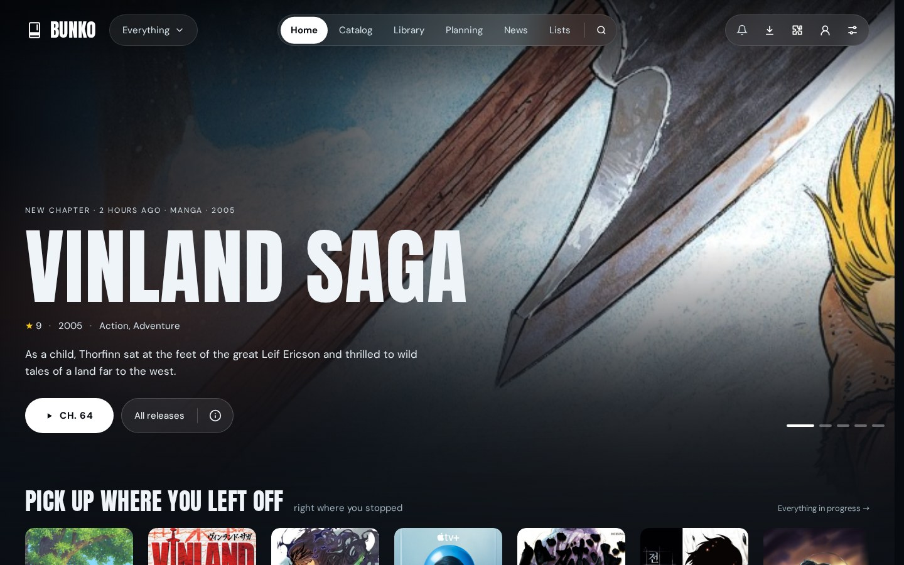
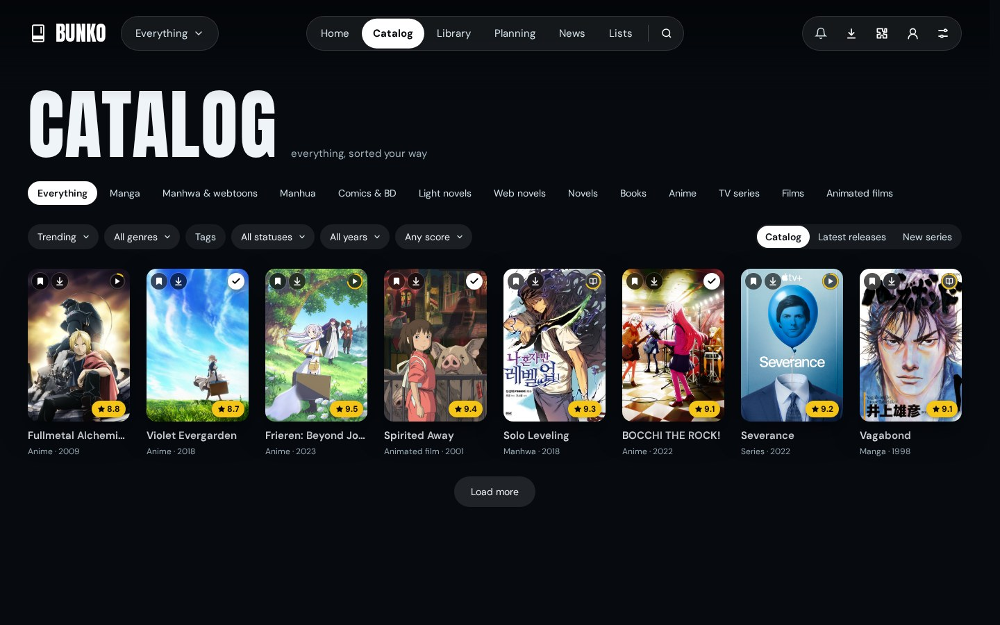
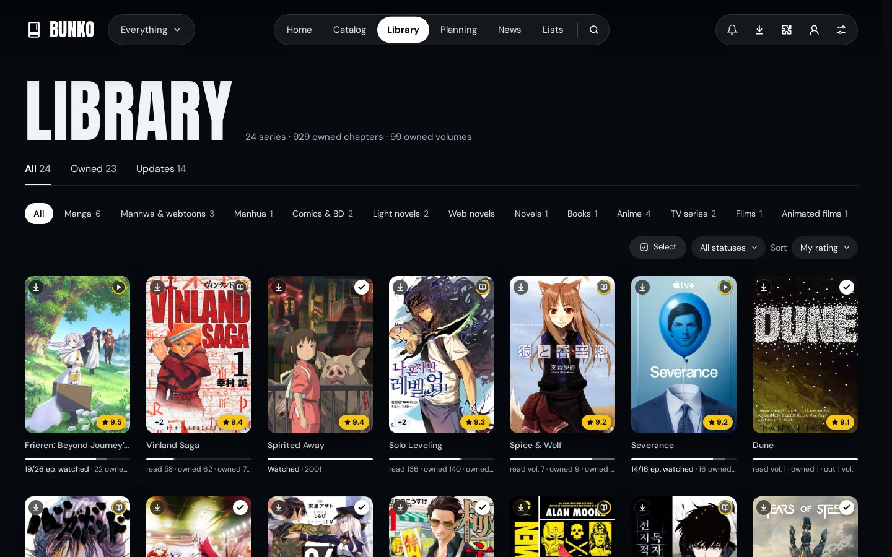
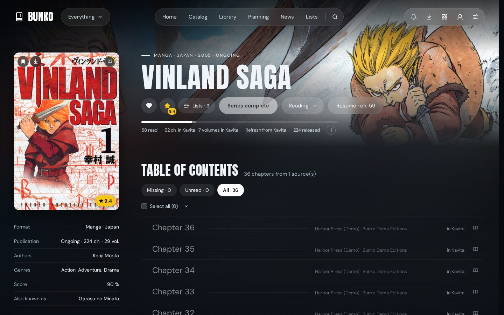
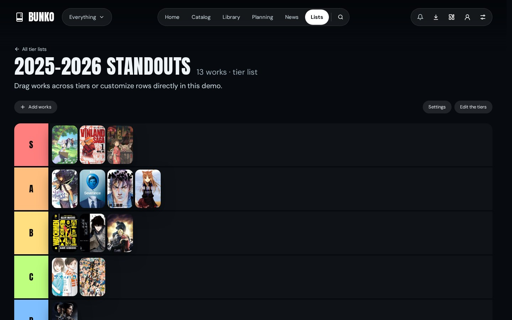
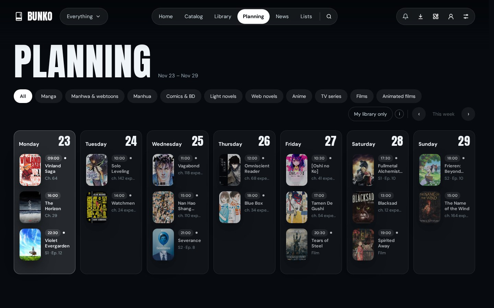
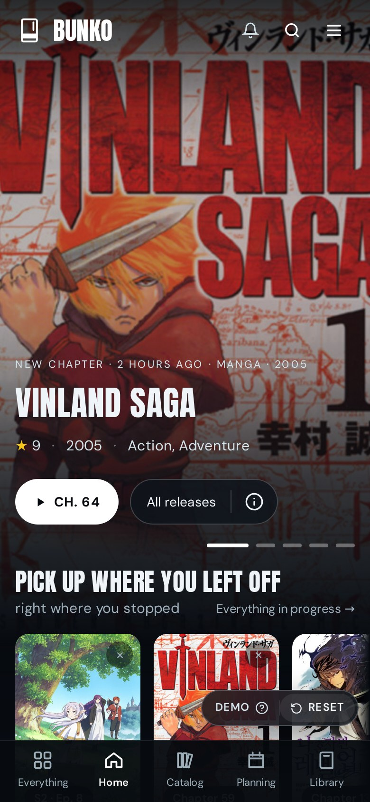

<div align="center">
  <picture>
    <source media="(prefers-color-scheme: dark)" srcset="docs/assets/logo-dark.svg" />
    
  </picture>
  <h1>Bunko</h1>
  <p><strong>A self-hosted reading, anime, and cinema hub for everything you read, watch, and rank.</strong></p>
  <p>
    <a href="https://bunko.lucas-homelab.fr">Website</a> ·
    <a href="https://demo.bunko.lucas-homelab.fr">Live demo</a> ·
    <a href="https://docs.bunko.lucas-homelab.fr/en/docs">Documentation</a> ·
    <a href="SECURITY.md">Security</a>
  </p>
  <p>
    <a href="https://github.com/lucas-lepajollec/bunko/actions/workflows/ci.yml"></a>
    <a href="https://github.com/lucas-lepajollec/bunko/pkgs/container/bunko"></a>
    <a href="LICENSE"></a>
  </p>
  
</div>

## Overview

Bunko brings discovery, progress tracking, built-in reading and playback, and curation into one self-hosted container on top of the servers you already run — [Suwayomi](https://github.com/Suwayomi/Suwayomi-Server), [Kavita](https://www.kavitareader.com/), [Jellyfin](https://jellyfin.org/), [Emby](https://emby.media/), [Sonarr](https://sonarr.tv/), [Radarr](https://radarr.video/), [Prowlarr](https://prowlarr.com/), [qBittorrent](https://www.qbittorrent.org/), [TraDoc](https://github.com/lucas-lepajollec/tradoc), and [Stash](https://stashapp.cc/).

| | What it does |
| --- | --- |
| **Unified discovery** | Browse manga, manhwa/webtoons, manhua, comics & BD, light novels, web novels, novels, books, anime, TV series, films, and animated films across AniList, MangaDex, MangaUpdates, Open Library, TMDB, and optional catalog keys. |
| **Built-in reader & player** | Read CBZ/CBR, EPUB, and PDF right in the browser (RTL/LTR/webtoon) and play video from Jellyfin, Emby, or Stash with HLS and optional WebGL 2 FSR 1 &amp; Anime4K upscaling. |
| **One-click acquisition & sync** | Match works to your Suwayomi extensions or *arr stack, import clean CBZ archives with embedded `ComicInfo.xml` into Kavita, and keep read/watched progress synced automatically. |
| **Curation & rankings** | Rate on a 1–10 scale, run head-to-head pairwise duels, build drag-and-drop ranked lists and tier lists, follow release planning and RSS/Atom news feeds, or import your Yamtrack history. |

Bunko ships with **no bundled content sources, scrapers, or extension repositories**.

## Product preview

All screenshots below are captured from Bunko's isolated [public demo](DEMO.md) with live public-API catalog metadata ([capture manifest](docs/assets/screenshots/manifest.json)).

<table>
  <tr>
    <td width="50%">
      <br />
      <sub><strong>Catalog</strong> — Filter and sort across 12+ reading and video kinds from one unified grid.</sub>
    </td>
    <td width="50%">
      <br />
      <sub><strong>Library</strong> — Status shelves, owned marks, unlinked inbox, and per-kind progress.</sub>
    </td>
  </tr>
  <tr>
    <td width="50%">
      <br />
      <sub><strong>Title sheet</strong> — Unified chapter/episode table, source matching, Kavita/Jellyfin sync, and reader resume.</sub>
    </td>
    <td width="50%">
      <br />
      <sub><strong>Lists &amp; Tier Lists</strong> — Drag-and-drop S/A/B/C/D tiers, ranked lists, and pairwise duels.</sub>
    </td>
  </tr>
</table>

<details>
  <summary>More views: Release planning and Mobile responsive layout</summary>
  <br />
  <table>
    <tr>
      <td width="65%">
        <br />
        <sub><strong>Planning</strong> — Weekly calendar of upcoming chapters, volumes, and episodes.</sub>
      </td>
      <td width="35%" align="center">
        <br />
        <sub><strong>Mobile</strong> — Touch-first navigation, swipe shelves, and mobile reader.</sub>
      </td>
    </tr>
  </table>
</details>

## Highlights

- **13 media kinds across reading and video**: manga, manhwa &amp; webtoons, manhua, comics &amp; BD, light novels, web novels, novels, books, anime, TV series, films, animated films, and user-configured extension sections.
- **Built-in readers**: chapter reader for CBZ and live Suwayomi pages (RTL, LTR, long-strip webtoon, preloading, resume), plus in-browser EPUB and PDF readers with typography controls.
- **Integrated video player &amp; GPU upscaling**: streams from Jellyfin, Emby, Stash, or user-added video extensions with unified subtitle menus (media server, HLS tracks, extensions) and client-side WebGL 2 FSR 1 &amp; Anime4K shaders.
- **9 self-hosted integrations**: Suwayomi, Kavita, Jellyfin, Emby, Sonarr, Radarr, Prowlarr, qBittorrent, TraDoc (AI book translation), and Stash — all through a plug-in integration registry with an Unlinked inbox to connect existing library items.
- **Lists, duels, tier lists &amp; News**: 1–10 ratings, pairwise duels, custom ranked lists and S/A/B/C/D tier lists, weekly planning, News feed with trailers and RSS/Atom subscriptions, and Yamtrack JSON import.
- **Multi-user isolation**: separate per-account SQLite database, library folders, integrations, progress, and least-privilege permissions (`member` vs `admin`).
- **Two visual themes &amp; 5 languages**: Ciné (cinema dark/night) and Bunko (bookshop light/dark) themes in English, French, Spanish, German, and Italian.

## Quick start

Bunko runs as a single hardened Docker container (multi-arch `amd64` and `arm64`, UID `1000`, read-only root filesystem, `cap_drop: ALL`).

**1. Create `docker-compose.yml`**

```yaml
services:
  bunko:
    image: ghcr.io/lucas-lepajollec/bunko:latest
    restart: unless-stopped
    ports:
      - '2512:2512'
    volumes:
      - bunko-data:/data
      # Replace the left side with the folder that contains your Kavita libraries.
      - /path/to/your/kavita/libraries:/library
    read_only: true
    tmpfs:
      - /tmp
    security_opt:
      - no-new-privileges:true
    cap_drop:
      - ALL

volumes:
  bunko-data:
```

**2. Start Bunko**

```sh
docker compose up -d
```

**3. Retrieve the first-start setup code and create your administrator account**

On first start (when no accounts exist yet), Bunko generates a one-time setup code in `/data/setup.code` and logs it once at startup (or you can pre-set `BUNKO_SETUP_CODE` in `.env` — see [`.env.example`](.env.example)):

```sh
docker compose logs bunko | grep -i "setup code"
```

Open `http://<your-host>:2512`, enter the setup code, and create your administrator account. Then configure your integrations in **Settings → Integrations** (Suwayomi, Kavita, Jellyfin, Emby, Sonarr, Radarr, Prowlarr, qBittorrent, TraDoc, Stash) and optional shared catalog keys in **Settings → Catalogs** (TMDB, Google Books, Metron, Rakuten Books, Hardcover).

<details>
  <summary><b>Multi-user household</b> — one container, isolated libraries per account</summary>
  <br />
  <p>Administrators create accounts in <strong>Settings → Users</strong>. Each account owns its own SQLite database, service connections, library, progress, lists, and permissions. Mount each user's Kavita folder under <code>/library</code> (two accounts cannot claim overlapping folders):</p>

```yaml
volumes:
  - bunko-data:/data
  - /path/to/first/kavita/libraries:/library/user1
  - /path/to/second/kavita/libraries:/library/user2
```
</details>

<details>
  <summary><b>All-in-one reading stack</b> — Bunko + headless Suwayomi + FlareSolverr</summary>
  <br />
  <p>Use <a href="docker-compose.full.yml"><code>docker-compose.full.yml</code></a> to start Bunko with an internal Suwayomi server and FlareSolverr (no extra published ports):</p>

```sh
docker compose -f docker-compose.full.yml up -d
```
  <p>Then add an extension repository you trust in <strong>Sources → Repositories</strong>. Bunko ships with none.</p>
</details>

## Configuration and persistence

| Variable | Default | Purpose |
| --- | --- | --- |
| `BUNKO_DATA_DIR` | `/data` | Persistent volume storing `accounts.db`, per-account databases (schema **v35**), `settings.key`, `session.key`, `access.token`, and `setup.code`. |
| `BUNKO_LIBRARY_DIR` | `/library` | Writable library root receiving imported CBZ/EPUB archives. |
| `BUNKO_SETUP_CODE` | _(auto-generated in `/data/setup.code`)_ | Optional pre-set first-start setup code for headless/automated deployments. |
| `SUWAYOMI_URL` | `http://suwayomi:4567` | Optional initial Suwayomi address; the address saved in Settings takes precedence. |
| `BUNKO_TRUST_PROXY` | `false` | Set to `true` only behind a trusted TLS reverse proxy to honor `X-Forwarded-Proto` (for `Secure` cookies) and `X-Forwarded-For` (for login rate limiting). |
| `BUNKO_SECURE_COOKIES` | _(auto from TLS/proxy)_ | Set to `true` behind HTTPS reverse proxies that do not forward `X-Forwarded-Proto`. |
| `BUNKO_RESET_ACCOUNT` | `false` | Set to `true` for a single restart to recreate a forgotten password (remove immediately afterward). |

- **Backups**: stop Bunko and back up `/data` as a single unit (`accounts.db`, account databases, `settings.key`, `session.key`, `access.token` belong together) alongside your media backup of `/library`.
- **Updates &amp; rollback**: pin an immutable version tag (`ghcr.io/lucas-lepajollec/bunko:1.0.0`) or pull `latest`. Schema migrations run automatically on startup (current tenant schema: **v35**). To roll back, stop the container and restore the matching pre-upgrade `/data` backup with the previous image digest.

## Security, privacy, and limitations

- **Authenticated by default**: first-start admin creation requires the one-time setup code (`/data/setup.code` or `BUNKO_SETUP_CODE`). Passwords use `scrypt` with bounded concurrency and per-IP login rate limiting; browser sessions use HMAC-SHA256 signed `HttpOnly`, `SameSite=Lax` cookies backed by a dedicated `/data/session.key` separate from credential encryption (`/data/settings.key`).
- **Hardened HTTP &amp; container defaults**: `X-Content-Type-Options: nosniff`, `X-Frame-Options: SAMEORIGIN`, `Referrer-Policy`, `Permissions-Policy`, CSP `frame-ancestors 'self'`, `Sec-Fetch-Site: cross-site` + `Origin`/`Host` CSRF rejection, read-only root filesystem, non-root UID 1000, `cap_drop: ALL`, and Trivy-scanned runtime images.
- **Least-privilege multi-user &amp; SSRF guards**: new `member` accounts receive minimal permissions by default; outbound fetches default to blocking private/loopback networks unless explicitly authorized for a configured integration; EPUB archive decompression and media proxy streams enforce strict byte caps.
- **No bundled sources**: Bunko does not host, bundle, or recommend content sources or extension repositories. Third-party metadata APIs (AniList, MangaDex, MangaUpdates, Open Library, TMDB, etc.) are queried server-side without exposing user credentials to the browser.

Please report vulnerabilities privately — see [SECURITY.md](SECURITY.md).

## Architecture

| Layer | Implementation |
| --- | --- |
| Application &amp; UI | Next.js 16 (App Router) + React 19 on Node 22 (`standalone` output in Docker), SWR client cache, WebGL 2 video shaders, `pdfjs-dist` &amp; EPUB/CBZ readers |
| Storage &amp; Worker | `better-sqlite3` (WAL mode + FTS5) with isolated per-account DBs (schema **v35**) + shared `accounts.db`; durable single-container background worker for imports, scans, and scheduled checks |
| Extensibility | Shared API contract ([`src/types/shared.ts`](src/types/shared.ts)), provider registry (`src/domain/providers.ts`), and integration registry (`src/domain/integrations.ts`) |

Reference docs: [Architecture](docs/architecture.md) · [API reference](docs/api.md) · [Video streaming](docs/video-streaming.md) · [Verification record](docs/verification.md)

## Development and quality

```sh
npm ci
npm run dev                  # Local dev server on http://127.0.0.1:2498
npm run demo                 # Local interactive demo (zero SQLite, fictional data)
npm run check                # ESLint, strict TypeScript, Vitest suite, production build
npm run demo:capture         # Reproduce docs/assets/screenshots/* and social-preview.png
```

CI validates lint, strict TypeScript, 860+ unit and multi-tenant isolation tests, production build, multi-arch `amd64`/`arm64` container smoke tests, Trivy vulnerability scanning, SPDX/SLSA provenance, Dependency Review, and CodeQL on every pull request.

## Public demo

Explore Bunko safely in your browser at **[demo.bunko.lucas-homelab.fr](https://demo.bunko.lucas-homelab.fr)** — a zero-SQLite, serverless demo preloaded with 28 fictional, original works across manga, manhwa, novels, anime, series, and films, complete with interactive library shelves, 1–10 ratings, tier lists, release planning, and a 3-page sample chapter reader. No personal servers or external copyrighted media are contacted, and the **Reset** chip restores the initial dataset at any time. See [DEMO.md](DEMO.md) to run it locally.

## Documentation and community

- [Website](https://bunko.lucas-homelab.fr) · [Documentation](https://docs.bunko.lucas-homelab.fr/en/docs) · [Live demo](https://demo.bunko.lucas-homelab.fr)
- [Contributing](CONTRIBUTING.md) · [Support](SUPPORT.md) · [Security](SECURITY.md) · [Code of conduct](CODE_OF_CONDUCT.md) · [Changelog](CHANGELOG.md)

Released under the [MIT License](LICENSE).
